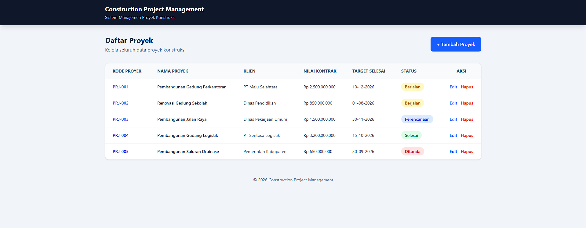
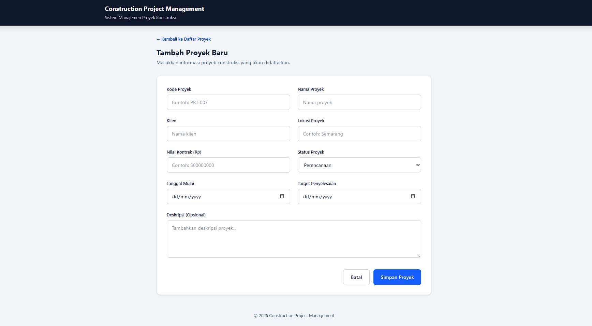

# Construction Project Management

Aplikasi web untuk mengelola data proyek konstruksi yang dikembangkan menggunakan **Laravel 11** sebagai bagian dari **Technical Assessment PT PWS**.

## Teknologi yang Digunakan

| Komponen | Teknologi |
|---|---|
| Backend | Laravel 11 |
| Frontend | Blade Template |
| CSS Framework | Tailwind CSS |
| Database | PostgreSQL 16 |
| Containerization | Docker & Docker Compose |
| Bahasa Pemrograman | PHP 8.2 |

## Fitur Aplikasi

1. Menampilkan daftar proyek konstruksi.
2. Menambahkan proyek baru.
3. Mengubah informasi proyek.
4. Menghapus proyek dengan konfirmasi.
5. Validasi input di sisi server.
6. Penyimpanan data menggunakan PostgreSQL.
7. Seeder untuk menyediakan data proyek simulasi.

## Struktur Data Proyek

| Field | Keterangan |
|---|---|
| Kode Proyek | Wajib dan unik |
| Nama Proyek | Wajib diisi |
| Client | Wajib diisi |
| Lokasi Proyek | Wajib diisi |
| Nilai Kontrak | Angka, minimal 0 |
| Tanggal Mulai | Wajib diisi |
| Target Penyelesaian | Tidak boleh sebelum tanggal mulai |
| Status | Perencanaan, Berjalan, Selesai, Ditunda |
| Deskripsi | Opsional |

## Persyaratan Instalasi

Pastikan perangkat sudah memiliki:

- Docker Desktop
- Docker Compose
- Git

## Cara Menjalankan Aplikasi

### 1. Clone Repository

```bash
git clone https://github.com/MRoynaldi-30/construction-project.git
```

Masuk ke direktori project:

```bash
cd construction-project
```

### 2. Konfigurasi Environment

Salin file `.env.example` menjadi `.env`.

Untuk Windows PowerShell:

```powershell
Copy-Item .env.example .env
```

Untuk Linux / macOS:

```bash
cp .env.example .env
```

Pastikan konfigurasi pada `.env` sesuai dengan konfigurasi Docker Compose:

```env
APP_NAME="Construction Project Management"
APP_ENV=local
APP_KEY=
APP_DEBUG=true
APP_URL=http://localhost:8000

DB_CONNECTION=pgsql
DB_HOST=postgres
DB_PORT=5432
DB_DATABASE=construction_db
DB_USERNAME=construction_user
DB_PASSWORD=construction_password
```

### 3. Generate Application Key

Generate key menggunakan PHP:

```bash
php -r "echo 'base64:'.base64_encode(random_bytes(32)).PHP_EOL;"
```

Salin hasilnya dan masukkan ke bagian `APP_KEY` pada file `.env`.

Contoh:

```env
APP_KEY=base64:HASIL_GENERATE_KEY
```

> Jika PHP tidak terpasang di komputer, `APP_KEY` juga bisa dibuat setelah container berjalan (langkah 5) dengan perintah:
> `docker compose exec app php artisan key:generate`

### 4. Build Docker Image

```bash
docker compose build
```

### 5. Jalankan Container

```bash
docker compose up -d
```

### 6. Jalankan Database Migration dan Seeder

```bash
docker compose exec app php artisan migrate:fresh --seed --force
```

### 7. Akses Aplikasi

Buka browser dan kunjungi:

```
http://localhost:8000/projects
```

## Perintah Docker

Melihat status container:

```bash
docker compose ps
```

Melihat log aplikasi:

```bash
docker compose logs app
```

Menghentikan container:

```bash
docker compose down
```

Menjalankan kembali container:

```bash
docker compose up -d
```

## Reset Database

Untuk menghapus seluruh tabel lalu membuat ulang beserta data simulasi:

```bash
docker compose exec app php artisan migrate:fresh --seed --force
```

> Perintah ini menghapus semua data yang ada di database.

## Screenshot Aplikasi

### 1. Halaman Daftar Proyek



### 2. Form Tambah Proyek



## Database

Database menggunakan **PostgreSQL 16** yang dijalankan melalui Docker Compose.

Aplikasi menyediakan seeder untuk memasukkan minimal lima data proyek simulasi sebagai contoh penggunaan.

## Catatan

Project ini dikembangkan untuk memenuhi kebutuhan Technical Assessment PT PWS.

Seluruh data proyek yang digunakan merupakan data simulasi.
